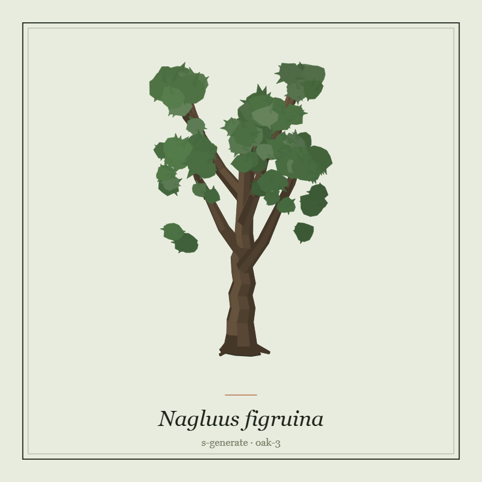
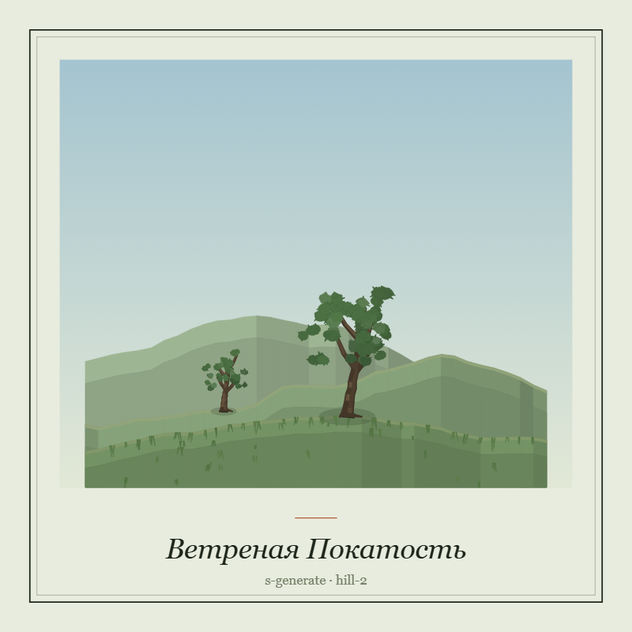
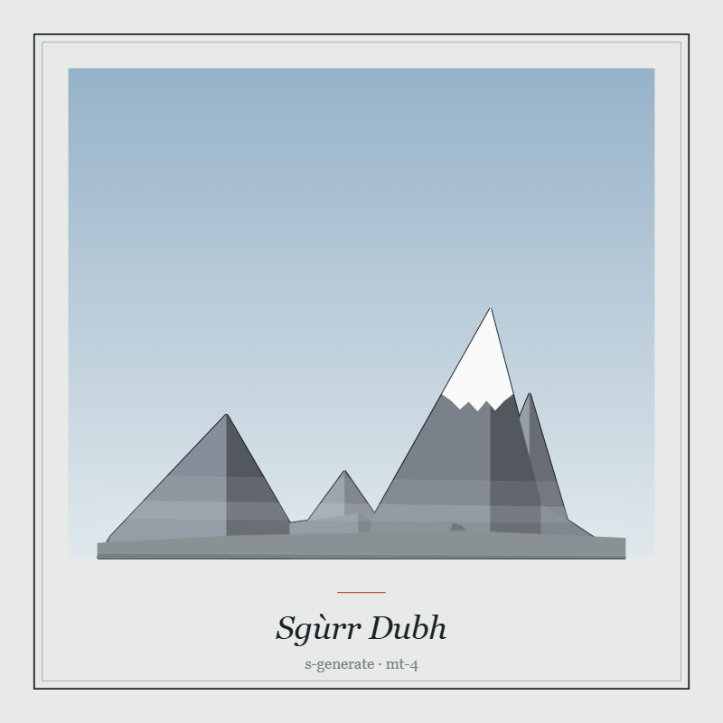
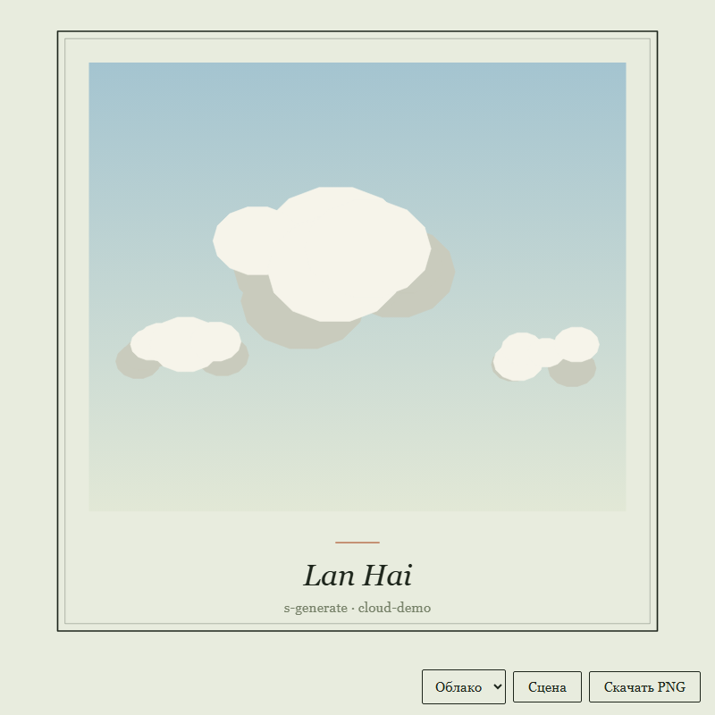
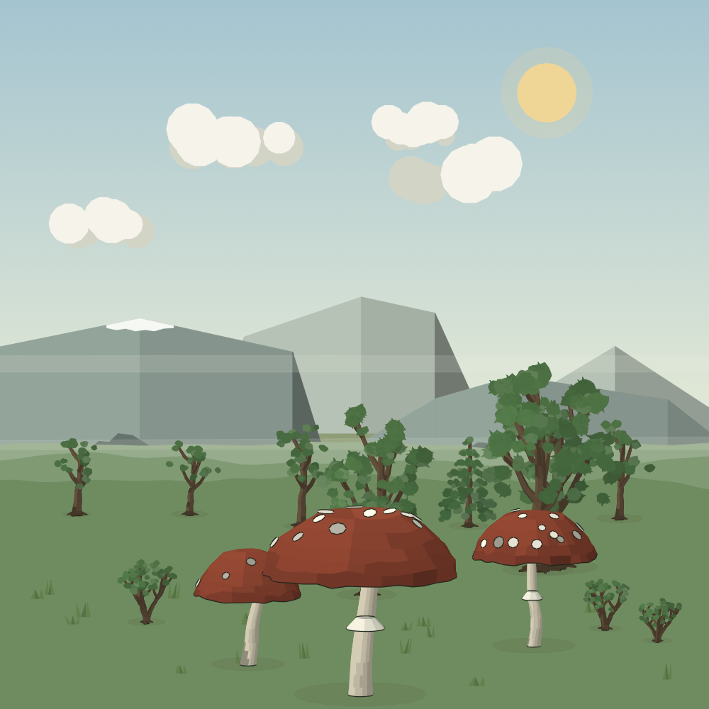

# s-generate

Генератор процедурной графики в браузере: **грибы, деревья, кустарники, холмы,
облака, горы**. Всё считается из строкового сида — один и тот же сид всегда даёт
один и тот же результат.

Два режима вывода:

* **плашка** — один объект на «бумаге»: рамка, подпись с латинским названием, сид;
* **сцена** — ландшафт: небо, дальние горы, холмы, лес, передний план.

Рендер — чистый Canvas 2D, без WebGL, библиотек и сборки. Экспорт — PNG, позже —
анимированный GIF.

## Статус

Пять родов генераций: **гриб, дерево, холм, гора, облако** — каждый со своей
школой имён, плашкой, рамкой и экспортом PNG. Плюс ландшафтная сцена, где всё
это живёт вместе. Хвойные деревья бывают елью, пихтой и сосной, у лиственных
видны отдельные листья, а горы и холмы освещены фасетами.

| Дерево (латынь) | Холм (славянские имена) | Гора (кельтские) | Облако (азиатские) |
|---|---|---|---|
|  |  |  |  |



Открыть: `?kind=mushroom|tree|hill|mountain|cloud` — род, `?mode=scene` — сцена;
`seed`, `palette`, `shape` и `habit` — в адресной строке. В панели есть выбор рода,
режима, формы гриба, характера дерева и палитры — девять тем, от «Бумаги» до «Ночи».

Кнопка «Ещё» (пробел или `R`) крутит сид без перезагрузки: новый сид сразу попадает
в URL, а «назад» в браузере возвращает предыдущий вариант. «Случайно» (клавиша `D`)
бросает новый сид вместе с родом, палитрой и характером; режим при этом не меняется.
Обе цепочки детерминированы: из одного и того же кадра всегда получается один и тот
же следующий, так что ссылка воспроизводит кадр и через год. GIF и анимация пока не
сделаны — см. [docs/PLAN.md](docs/PLAN.md).

## Запуск

```bash
npm start   # http://localhost:8080
npm test    # тесты, node --test
```

Порт можно переопределить: `PORT=8099 npm start` (PowerShell: `$env:PORT=8099; npm start`).

Зависимостей нет: `npm install` не нужен, Node используется только как статический
сервер и раннер тестов.

## Структура

```
index.html          — точка входа, <script type="module" src="src/app/main.js">
src/core/           — RNG, математика, сплайны, шум, палитры
src/model/          — генераторы форм и имён
src/scene/          — композиция, размещение, свет
src/render/         — display list → canvas, контур, зерно, рамка
src/export/         — PNG, GIF, квантование
src/ui/             — контролы, URL, скачивание
docs/               — план, архитектура, каталог родов, экспорт, журнал решений
tools/serve.mjs     — статический сервер на встроенных модулях Node
test/               — unit и golden-тесты
```

## Документация

| Файл | О чём |
|---|---|
| [AGENTS.md](AGENTS.md) | Правила репозитория и ограничения |
| [docs/PLAN.md](docs/PLAN.md) | Объём проекта, этапы, открытые вопросы |
| [docs/ARCHITECTURE.md](docs/ARCHITECTURE.md) | Как устроен движок |
| [docs/CONTENT.md](docs/CONTENT.md) | Что и как генерируется |
| [docs/EXPORT.md](docs/EXPORT.md) | PNG и GIF своими руками |
| [docs/RESEARCH.md](docs/RESEARCH.md) | Исходный ресёрч |
| [docs/DECISIONS.md](docs/DECISIONS.md) | Почему сделано именно так |

## Лицензия

* **Код** — [MIT](LICENSE): используй, меняй, распространяй, сохрани уведомление о
  копирайте.
* **Сгенерированные изображения** — общественное достояние (CC0): делай что хочешь,
  ссылка приятна, но не обязательна.

Почему так — [docs/DECISIONS.md](docs/DECISIONS.md), D-015.
